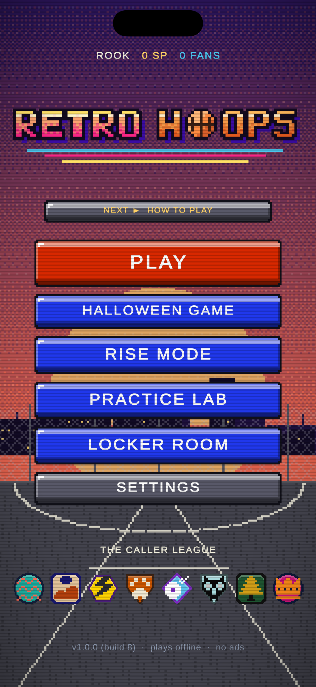
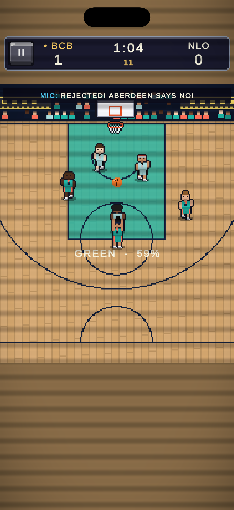
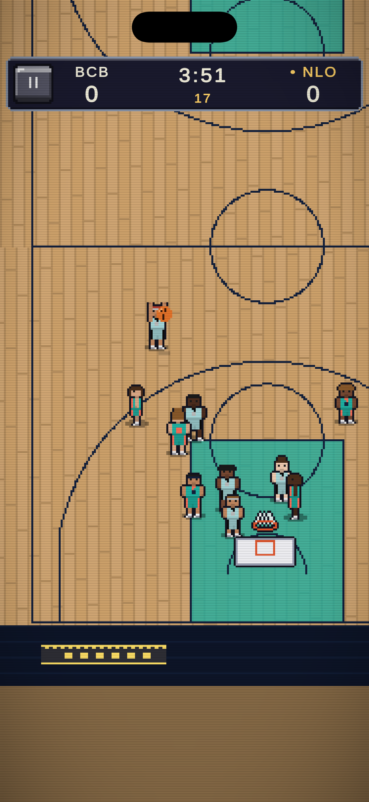
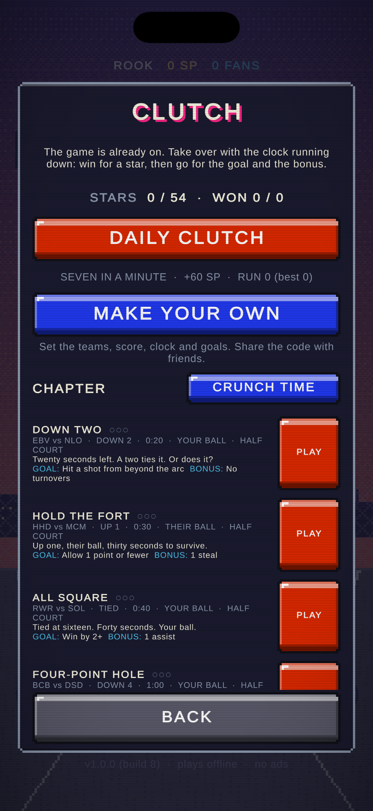
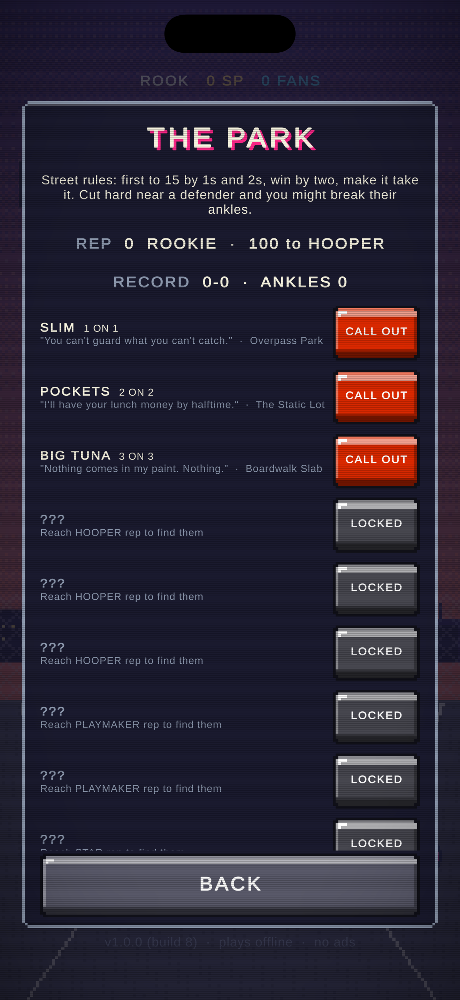
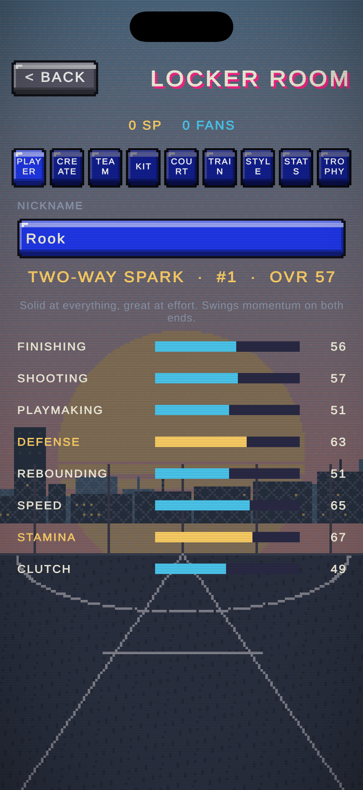

# RETRO HOOPS

**Call your shot. Build your legacy.**

Pixel-art 3v3 streetball for iPhone. Works offline. No ads.

    

---

## 🏀 Tip-off: how to join the beta

**Four quarters. About two minutes. You're in.**

| | Play | What to do |
|:-:|---|---|
| **Q1** | **Get TestFlight** | Install Apple's free [TestFlight](https://apps.apple.com/app/testflight/id899247664) app on your iPhone. |
| **Q2** | **Check in** | Open **[testflight.apple.com/join/6F4CqA1R](https://testflight.apple.com/join/6F4CqA1R)** on that iPhone and tap **Accept**, then **Install**. |
| **Q3** | **Make your tester card** | Open Retro Hoops. The **BETA TESTER** screen asks for your name or @handle and how much you hoop. It stays on your phone. |
| **Q4** | **Hoop, then talk your talk** | Play a few games. When something's broken, confusing or fire, tap **SEND FEEDBACK** on the main menu. |

> **"No builds available"?** The next beta is waiting on Apple's review. Keep the link and check back. Once you've joined, TestFlight updates the game for you.

## 📣 Sending feedback (the SEND FEEDBACK play)

1. Tap **SEND FEEDBACK** on the main menu. Your tester card, build number, phone and game stats get copied.
2. Take a **screenshot** (side button + volume up).
3. Tap the screenshot preview, then **Share Beta Feedback**. Or press and hold the Retro Hoops icon and tap **Send Beta Feedback**.
4. **Paste** and tell us what happened. It goes straight to the developer through TestFlight.

Crashes are reported through TestFlight automatically. The game itself never sends your info anywhere.

## 🎯 Scouting report: what we want to know

- **First minute:** did your first game make sense without help?
- **Feel:** do the stick, shot meter and buttons feel right on your phone?
- **Balance:** anything too hard, too easy, or broken?
- **Your favourite:** which mode kept you playing?
- **Would you pay $3.99 once** for Retro Hoops Pro (Franchise, more Rise seasons, every cosmetic)? In TestFlight it's free to try.

## 🕹️ What's in the game

- **Quick games** in 3v3, 1-on-1 and Full Court 5-on-5
- **Rise Mode:** take your crew from the blacktop to the title. **Create yourself** and your teammates.
- **CLUTCH:** win late-game scenarios, plus a daily one
- **The Park:** street challenges and ankle-breaking crossovers
- **LIVE:** free online games through Game Center, with a points leaderboard and monthly divisions
- **Franchise** (Pro): run a club for seasons, with created players

All teams, players, courts, logos, art and audio are original.

---

## 🛠️ For developers

An original, offline, portrait-first retro arcade 3v3 basketball game for iPhone, built in Unity 6 LTS.

- **Unity project:** [`RetroHoops/`](RetroHoops/) — setup, controls, iOS build steps, and architecture are in [`RetroHoops/README.md`](RetroHoops/README.md).
- **Plan and phase log:** [`RetroHoops/docs/PLAN.md`](RetroHoops/docs/PLAN.md)
- **Design:** [`RetroHoops/DESIGN.md`](RetroHoops/DESIGN.md)
- **Release checklist and App Store kit:** [`RetroHoops/docs/RELEASE_CHECKLIST.md`](RetroHoops/docs/RELEASE_CHECKLIST.md), [`RetroHoops/docs/APP_STORE.md`](RetroHoops/docs/APP_STORE.md)
- **Game Center setup:** [`RetroHoops/docs/GAME_CENTER.md`](RetroHoops/docs/GAME_CENTER.md)
- **Manual QA checklist:** [`RetroHoops/docs/QA_CHECKLIST.md`](RetroHoops/docs/QA_CHECKLIST.md)
- **Command-line iOS build (macOS, Unity 6 installed):** `tools/build_ios.sh [simulator|device]`
- **Logic tests without Unity:** `cd tools/LogicTests && dotnet run --project Runner/Runner.csproj`

**Status (12 Oct 2026):** v1.0 is feature-complete and in TestFlight beta. Builds 11 and 12 are uploaded; build 12 adds the TestFlight-only tester card and SEND FEEDBACK. App Store submission is planned for late October. The game logic passes 842 automated tests on .NET, and every assembly compiles against Unity 6000.6.3f1's reference assemblies (tools/UnityCheck). New features after v1 (fouls, take the charge and more) are in progress for v1.1.

All teams, players, courts, logos, art, and audio are original and generated procedurally in the project.
